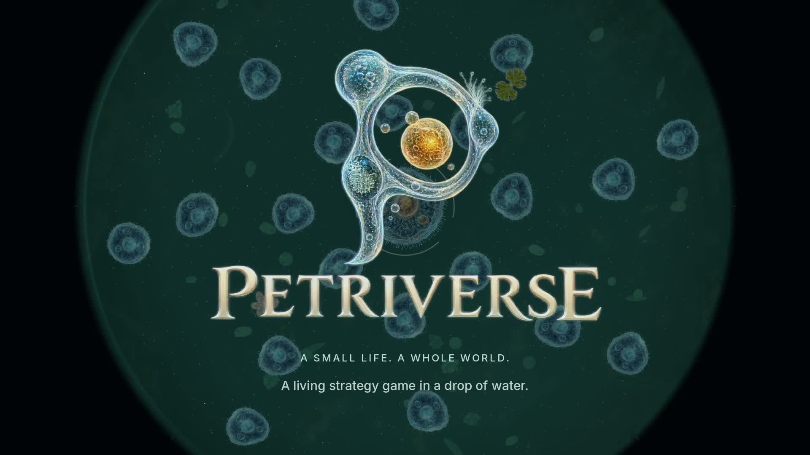
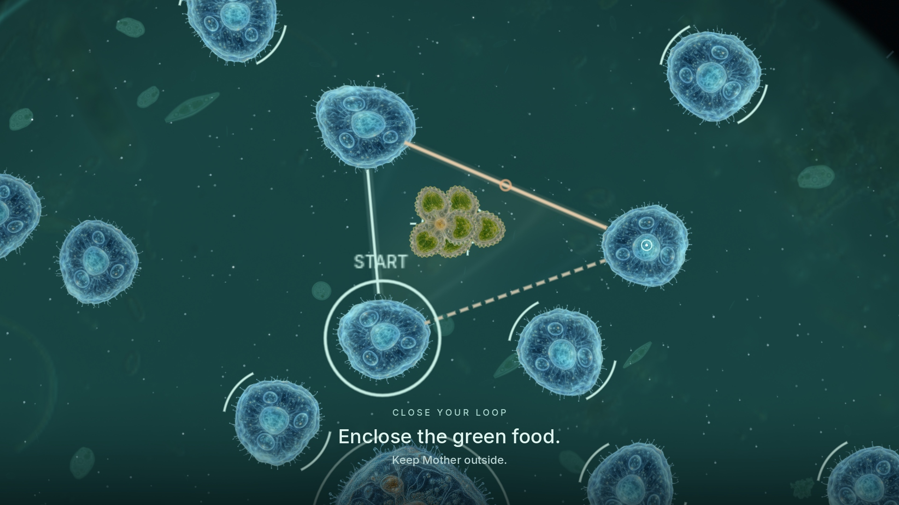
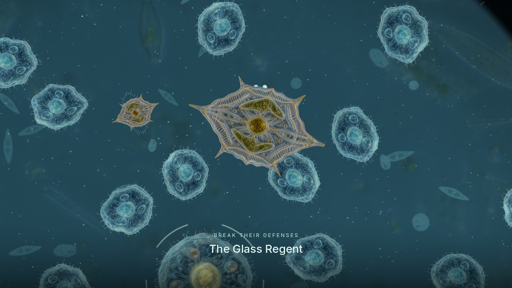
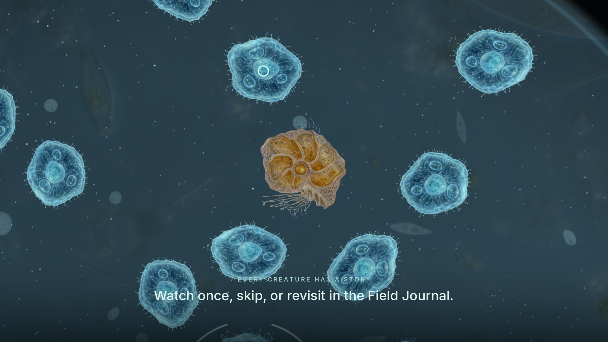
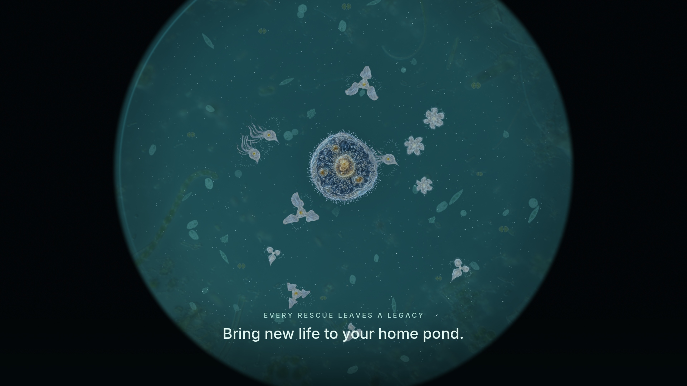

# Petriverse

[](trailer/Petriverse-trailer-0.2.3.mp4)

A living strategy game in a drop of water. You guide a microscopic colony through three petri dishes by drawing membranes between its cells: enclose food to feed, enclose threats to stop them, and keep the mother cell alive long enough to evolve.

Version 0.2.3. Single player, mouse driven, built with Godot 4.7 for macOS, Windows and Linux. [Watch the 90-second trailer](trailer/Petriverse-trailer-0.2.3.mp4).

The game was developed under the working title Microverse, which is still the repository name. The Godot project lives in `prototype/`.

## How it plays

Your colony is a mother cell surrounded by smaller blue cells. Hold the mouse on a ready cell, drag through 3-8 cells, and return to the first one to close a membrane. Everything whose nucleus lies inside is absorbed. Green desmids are food. Violet spiked cysts poison any meal they end up in, so you nudge them into clear water first. Hunters swim toward the mother and eat her health organelles, pearl spores are young colonies waiting to be rescued, and the mother herself must stay outside every loop. Used cells need time to recover, so each capture leaves a gap somewhere else in the dish.

A journey is fifteen encounters across three dishes, and each dish ends with a boss:

| Dish | What changes | Boss |
| --- | --- | --- |
| Stillwater | Quiet water and an open layout, where the lessons happen | Bellwether inhales food and poison alike and can only be struck during its 16-second exhale |
| Glassgarden | A narrower colony and a tide that reverses every 18 seconds | Glass Regent hides behind pairs of linked shield organisms that must be captured together |
| Blue Deep | A wider colony, a slowly turning current and linked predators | Conjoined has two drifting hearts that must be caught in a single loop |

Twelve authored encounters teach and test each mechanic. Three seeded special visits vary the objectives, creature mix, arrival directions and ecological events, so each journey takes a different route. Between them the dish fills with food thieves, cell-blocking parasites, hunters that divide in two, amoebas that swallow your cells, and bacteriophages you can steer onto copper bacteria. After the first two encounters, most stops let you choose a habitat: food-rich water with the usual hunters, or a sheltered route with smaller blooms, fewer hunters and a guaranteed rare visitor.

Food carries over between encounters and pays for evolution. There are twelve mutations and room for six per colony, built around fast small meals, wide feasts, feeding on captured threats, filtering poison or regrowing organelles. The mother grows from three to seven organelles over the journey, and her body changes with her first major mutation. The Wanderer colony is available from the start; clearing Stillwater unlocks the Weaver and clearing Glassgarden unlocks the Symbiont.

Rescued organisms move into your home pond, where you can name them and watch them grow. Each of the 44 discoverable creatures and forms has a short narrated film showing how it behaves. A first sighting offers the film without interrupting play, and the Field Journal keeps every film for later.

Progress saves automatically, including mid-encounter. A failed encounter can be retried from its start without losing earlier evolution.

<p>
  
  
</p>
<p>
  
  
</p>

## Playing

Petriverse needs [Godot 4.7](https://godotengine.org/download) (tested with 4.7.2 stable) and uses the Compatibility renderer. Music, narration, art and fonts are all in the repository. The game makes no network requests and needs no API keys.

```sh
git clone https://github.com/TheMarco/microverse.git
cd microverse
godot --path prototype
```

You can also open `prototype/project.godot` in the Godot editor and press F5. On macOS, double-clicking `prototype/Launch.command` starts the game with `godot` from your PATH or with `/Applications/Godot.app`.

Choose **New journey** on the title screen. The first encounter is a guided lesson, and **H** shows the loop gesture, an organism key and the current objectives at any time.

| Action | Control |
| --- | --- |
| Draw a membrane | Hold the left mouse button on a ready cell and drag through other ready cells |
| Capture | Return to the first cell after 3-8 cells and release |
| Backtrack | Move back to the previous cell |
| Cancel | Right-click, Escape, or release an open path |
| Nudge a cyst or phage cluster | Drag it toward clear water and release (six-second cooldown) |
| Choose an evolution | Click a card or press 1, 2 or 3 |
| Pause | Space |
| How to play | H |
| Field Journal | J |
| Settings | V |
| Switch to click input | C |
| Reduced motion | M |
| Retry a failed encounter | R |

Settings cover music and effect volume, input mode, motion, text size and visual detail. Losing window focus pauses the game.

Saves, unlocks and preferences are stored in Godot's user data folder, in `Godot/app_userdata/MICROVERSE` under `~/Library/Application Support` on macOS or `%APPDATA%` on Windows, and in `~/.local/share/godot/app_userdata/MICROVERSE` on Linux.

## Building releases

`prototype/export_presets.cfg` has `macOS`, `Windows` and `Linux` presets that write to `dist/0.2.3/`. Install the Godot 4.7.2 export templates, then run:

```sh
godot --headless --path prototype --export-release macOS
godot --headless --path prototype --export-release Windows
godot --headless --path prototype --export-release Linux
```

The macOS preset signs with a Developer ID identity from the Keychain; change its signing options to export without one. Build archives are not tracked in Git. [dist/README.md](dist/README.md) has the 0.2.3 release notes and verification summary, and [dist/SHA256SUMS.txt](dist/SHA256SUMS.txt) has the archive checksums.

## Development

`prototype/test.sh` runs the headless test suites. It uses `godot` from your PATH unless `GODOT_BIN` is set:

```sh
GODOT_BIN=/Applications/Godot.app/Contents/MacOS/Godot prototype/test.sh
```

Native and visual fixtures in `prototype/tests/` run individually; [prototype/README.md](prototype/README.md) lists them with the detailed rules, balance notes and verification results for each feature.

| Path | Contents |
| --- | --- |
| `prototype/` | The Godot project: scenes, scripts, shaders, art, audio, data and tests |
| `tools/` | Audio generation, narration import, trailer rendering and release scripts |
| `trailer/` | Trailers and the gameplay footage they are cut from |
| `artifacts/` | Audio generation requests and narration provenance |
| `dist/` | Release notes, checksums, third-party notices and verification reports |
| `Microverse_Game_Design_Spec_v0_1.md` | The original design specification |
| `Microverse_First_Prototype_Brief.md` | The brief for the first prototype |

`tools/generate_audio.py` regenerates the ElevenLabs sound assets and reads `ELEVENLABS_API_KEY` from the environment. Playing the game never needs it.

## Credits

Created by Marco van Hylckama Vlieg. Built with [Godot Engine](https://godotengine.org). Creature narration (voice: Willa Ashford) and sound effects were generated with ElevenLabs. Interface type is [Inter](https://rsms.me/inter/).

## License

Petriverse is licensed under [Creative Commons Attribution-NonCommercial 4.0 International](https://creativecommons.org/licenses/by-nc/4.0/) (CC BY-NC 4.0). You may share and adapt the game's code, art, audio and text for non-commercial purposes, as long as you credit Marco van Hylckama Vlieg and indicate any changes. Commercial use requires permission. The full legal code is in [LICENSE](LICENSE).

Godot Engine is MIT licensed and Inter is licensed under the SIL Open Font License 1.1; both keep their own terms. See [dist/THIRD-PARTY-NOTICES.txt](dist/THIRD-PARTY-NOTICES.txt) and [prototype/assets/fonts/OFL.txt](prototype/assets/fonts/OFL.txt).
